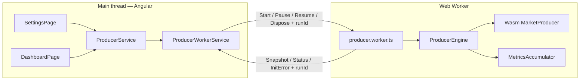

# Realtime Fintech Market Dashboard

Test-task implementation: a zoneless **Angular 21** dashboard that simulates high-frequency market data, aggregates trading metrics off the main thread, and renders a live instrument table with configurable producer settings.

|                |                                                        |
| -------------- | ------------------------------------------------------ |
| **Live demo**  | _TODO: `https://<github-user>.github.io/<repo-name>/`_ |
| **Repository** | _TODO: `https://github.com/<github-user>/<repo-name>`_ |

## Overview

The app exposes two routes:

- **Dashboard** — PrimeNG table with last price, bid/ask, spread, volume, notional, and order-book imbalance; pause/resume and nominal vs actual update rate.
- **Settings** — reactive form (instrument count, batch size, interval) validated against limits; **Apply** starts or restarts generation with a new seed.

Market ticks are produced in **Rust/WebAssembly** inside a dedicated **Web Worker**. Rolling metrics are computed in the pure TypeScript **`@test/market-engine`** library (`MetricsAccumulator`, `ProducerEngine`). The main thread only receives throttled snapshots via **`ProducerService`** (Angular signals).

Stack: **Nx 22**, **Angular 21**, **PrimeNG 21**, **Tailwind 3**, **Jest**, **Rust + wasm-pack**.

## Prerequisites

| Tool              | Version / notes                                                                            |
| ----------------- | ------------------------------------------------------------------------------------------ |
| **Node.js**       | **24.x** (matches [CI](.github/workflows/deploy.yml))                                      |
| **npm**           | Comes with Node; lockfile is `package-lock.json`                                           |
| **rustup**        | Recommended over Homebrew-only `cargo` (needs `wasm32` target)                             |
| **wasm32 target** | `rustup target add wasm32-unknown-unknown`                                                 |
| **wasm-pack**     | [Install](https://rustwasm.github.io/wasm-pack/installer/) (e.g. `brew install wasm-pack`) |

### PATH notes

After `rustup-init`, ensure **`~/.cargo/bin`** is on your `PATH` so `cargo`, `rustc`, and `rustup` resolve to the toolchain that has `wasm32-unknown-unknown`. If `cargo test` in `libs/market-producer-wasm` fails with a missing target, run `rustup target add wasm32-unknown-unknown` for the active toolchain (`rustup show active-toolchain`).

`wasm-pack` must be available when building the app: `market-dashboard` depends on `market-producer-wasm:build`, which runs `wasm-pack build`.

## Install

```bash
git clone <your-repo-url>
cd <repo-name>
npm ci
```

Building or serving the app triggers a Wasm release build on first run (via Nx `dependsOn`).

## Development

```bash
# Dev server (builds wasm + Angular, hot reload)
npx nx serve market-dashboard

# Same, explicit development configuration
npx nx serve market-dashboard --configuration=development
```

Open the URL printed by the dev server (typically `http://localhost:4200`). Use **Settings → Apply** to start the producer.

Serve the production bundle locally:

```bash
npx nx run market-dashboard:build:production
npx nx run market-dashboard:serve-static
```

## Test

```bash
# All lint + unit tests + builds (what CI runs before Pages-specific build)
npm run ci

# Shorthand scripts from package.json
npm run lint    # nx run-many -t lint --all
npm run test    # nx run-many -t test --all
npm run build   # nx run-many -t build --all

# Individual projects
npx nx test market-engine
npx nx test market-dashboard
npx nx run market-producer-wasm:test   # cargo test in libs/market-producer-wasm
```

Rust tests cover batch shape, invariants, determinism by seed, and price continuity. Jest covers metrics accumulation, engine scheduling/snapshot throttle, `ProducerService` + fake worker, and settings validators.

## Production build

```bash
npx nx run market-dashboard:build:production
```

Output: `dist/apps/market-dashboard/browser/` (includes hashed assets and copied `public/wasm/`).

For **GitHub Pages** project sites, the base href must include the repository name:

```bash
npx nx run market-dashboard:build:production --baseHref=/<repo-name>/
```

## CI and GitHub Pages

Deployment is defined in [`.github/workflows/deploy.yml`](.github/workflows/deploy.yml).

On every push to **`main`**:

1. Node **24**, Rust **stable** with **`wasm32-unknown-unknown`**, **wasm-pack**
2. `npm ci` → `npm run ci` (`lint`, `test`, `build` for all projects)
3. Production build with `--baseHref=/${{ github.event.repository.name }}/`
4. Copy `index.html` → `404.html` for client-side routing on Pages
5. Upload artifact and **deploy-pages**

**One-time repo setup:** Settings → Pages → Source: **GitHub Actions**. After the first successful run, set the live demo URL in this README.

## Architecture



**Data path:** Wasm `generate_batch(n)` returns a struct-of-arrays **`Int32Array`** (`n × 7` fields per trade: instrument index, price, qty, bid, ask, bid qty, ask qty). The worker feeds batches into `MetricsAccumulator`; snapshots are **`InstrumentMetrics[]`** posted to the UI.

**Lifecycle:** A single worker is created at app init (`ProducerWorkerService`). **Apply** frees the old Wasm producer, creates a new one, resets the accumulator, and bumps **`runId`**. **Dispose** on teardown terminates the worker.

## Design decisions

### Metrics in the worker (TypeScript), not in Rust

Wasm focuses on fast pseudo-random market simulation. Aggregation lives in **`market-engine`** so Jest can test formulas (spread, imbalance, notional) without loading Wasm. An alternative—compute everything in Rust and send only snapshots—would reduce JS work but weaken unit-test coverage and couple UI metrics to the crate.

### `Int32Array` struct-of-arrays (SoA)

Each batch is a flat typed array instead of JSON objects. That avoids serialization overhead and extra allocations when crossing the Wasm/JS boundary; the worker applies one linear scan per batch.

Prices and book levels are **integer cents** in the wire format; the UI formats USD via pipes.

### `runId`

`ProducerService` increments **`runId`** on every **Apply**. Worker messages carry the same id; stale messages (e.g. after a quick re-apply or late snapshot from a previous run) are ignored. Snapshots for the **current** run that arrive **after Pause** are still accepted—they reflect trades generated before the timer stopped.

### Snapshot throttling (~100 ms)

`ProducerEngine` emits snapshots at most about once per **`DEFAULT_SNAPSHOT_INTERVAL_MS`** (100 ms), with leading and trailing edges. Every trade is still applied to the accumulator immediately, so throttling only affects UI refresh rate, not metric correctness.

### No catch-up batches after Pause

**Pause** clears the scheduler timer. **Resume** schedules the next batch from “now”, without generating bursts to fill the paused interval. Nominal rate comes from settings; **actual rate** reflects measured throughput (useful when batches run slower than the configured interval).

### Scheduler behavior under load

Scheduling uses a self-correcting **`setTimeout`**. If a batch overruns its interval, the next tick runs as soon as possible rather than stacking delayed catch-up work.

## Repository structure

```
apps/market-dashboard/     Angular app (layout, dashboard, settings, producer.worker)
libs/market-engine/        Pure TS: MetricsAccumulator, ProducerEngine, message types
libs/market-producer-wasm/ Rust crate + wasm-pack → public/wasm assets
libs/shared/utils/         Shared helpers (e.g. isNil)
.github/workflows/         deploy.yml — CI + GitHub Pages
AGENTS.md                  Local agent/orchestrator notes for this repo
```

Feature code follows NgModule layout: lazy routes, `declarations/` barrels, **`ProducerService`** as the only UI entry to worker logic (components do not construct workers directly).

## License

MIT (see `package.json`).
